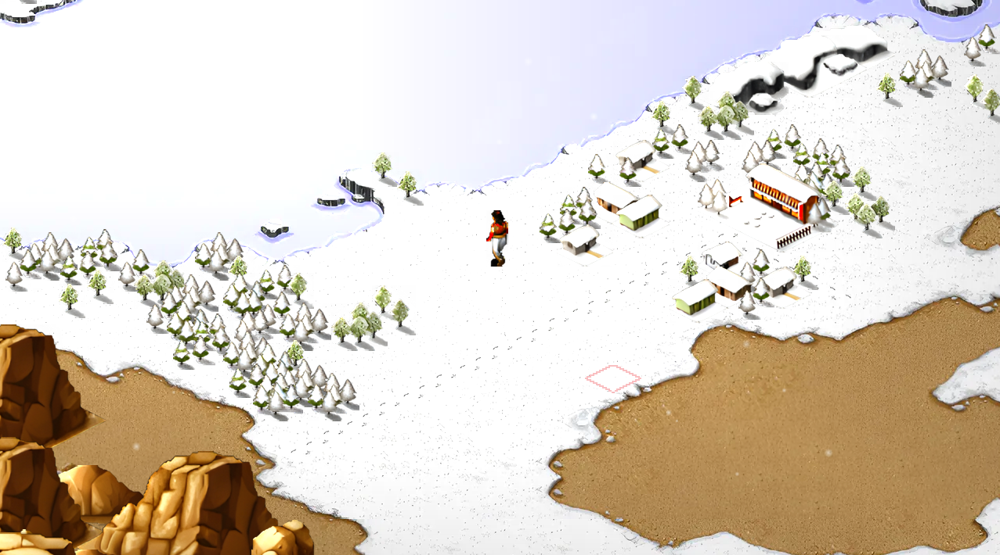
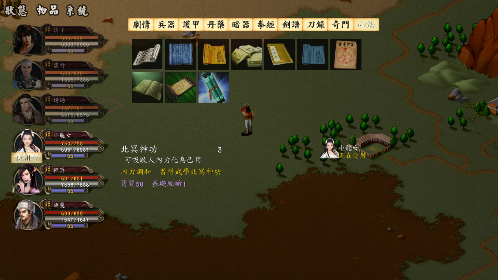
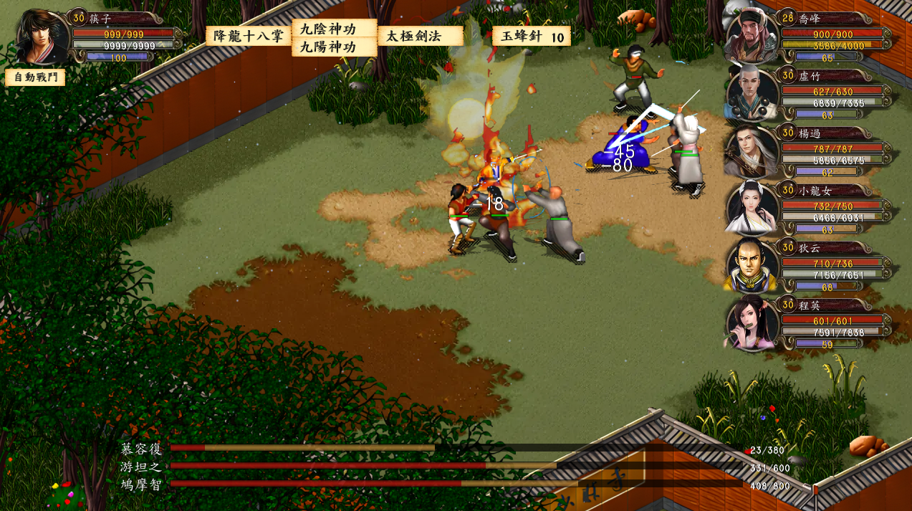
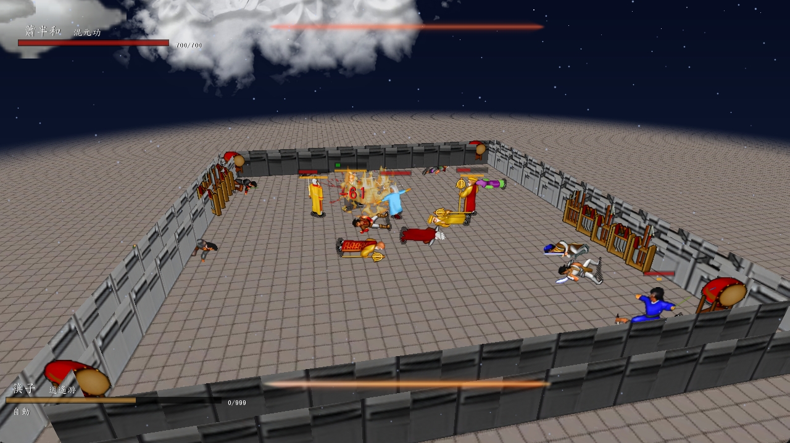

# kys-cpp

金庸群侠传复刻版，为区别于其他语言的复刻版，添加后缀cpp。

除了经典的回合制战斗外，还包含半即时战斗（含进度条），以及两种完全即时战斗模式。即模仿黑帝斯和只狼的战斗系统。可以通过游戏中的设置选项来切换。

github：https://github.com/scarsty/kys-cpp

码云（不定期同步）：https://gitee.com/scarsty/kys-cpp

资源文件：<http://pan.baidu.com/s/1sl2X9wD>

目前的开发分支为“纸片”，即试图营造一个真3D效果，但因素材限制，只能以纸片形式展示。大致类似“纸片马力欧”和“饥荒”的效果。

## 如何编译

Windows下建议先安装vcpkg，并在vcpkg目录中执行：
```bat
.\vcpkg install sdl3 sdl3-ttf sdl3-mixer[fluidsynth,mpg123] sdl3-image[png,webp] sqlite3 libiconv asio picosha2 yaml-cpp glaze
```
建议执行：
```bat
.\vcpkg.exe integrate install
```
获取子模块：

```shell
git submodule sync --recursive
git submodule update --init --recursive
# 可选
git submodule update --remote --rebase --recursive
```
之后使用 Visual Studio （需安装“使用 C++ 的桌面开发”组件）打开 `kys.sln`，编译 `x64` 配置即可。当前工程使用 v145 工具集，Visual Studio 2026 已验证；如需要 x86 版请自行修改工程。

macOS下可使用Homebrew安装依赖：
```shell
brew install cmake sdl3 sdl3_image sdl3_ttf sdl3_mixer sqlite yaml-cpp glaze
```

同样建议先获取子模块：

```shell
git submodule sync --recursive
git submodule update --init --recursive
```

之后执行：

```shell
mkdir -p src/build
cmake -S src -B src/build
cmake --build src/build -j8
```

编译产物为 `src/build/kys`。

运行时需要提供资源目录，作为命令行参数。例如：

```shell
./src/build/kys kys-cpp-4in1/game
```

若提示找不到字体或资源，一般是资源根目录多套了一层；请确认传入的是具体游戏目录，而不是其上一级打包目录。

上面的方法不含播放视频功能。如需要此功能，例如播放开场动画，则需先编译smallpot的动态库，比较复杂，请与作者联系。

Linux下编译参考doc目录中的文档。需注意没有联机对战部分。

对依赖的详细解释见doc目录中的“依赖库.md”。

简繁转换的词汇表取自OpenCC，但因为这个库的依赖太复杂，没有直接使用，而是自编了一个SimpleCC代替。

## MCP（CLI / stdio）

桌面版可作为本地 MCP Server 启动，仍显示游戏窗口，不需要 Node.js、额外服务或网络端口：

```powershell
.\x64\Release\kys.exe "D:\path\to\game" --mcp-stdio
```

在 VS Code 的 MCP 配置中添加（替换为实际绝对路径）：

```json
{
  "servers": {
    "kys": {
      "type": "stdio",
      "command": "D:\\kys-all\\_cpp\\kys-cpp\\x64\\Release\\kys.exe",
      "args": ["D:\\kys-all\\_cpp\\kys-cpp\\work\\game-dev", "--mcp-stdio"]
    }
  }
}
```

客户端启动并拥有一个独立游戏进程；这不是连接已运行游戏的接口。普通启动不启用 MCP。MCP 模式的 stdout 仅用于换行分隔的 JSON-RPC，游戏日志转至 stderr；关闭 stdin 会退出该游戏进程。需要有效游戏资源及可用的图形/音频环境，并非无界面模式。

当前工具：

| 工具 | 参数 | 功能 |
|---|---|---|
| `get_game_state` | 无 | 当前输入上下文、地图、已提交的玩家坐标、移动和加载状态 |
| `get_party` | 无 | 队伍成员的等级、生命和内力；未加载时为空 |
| `get_inventory` | 无 | 非空背包槽位；未加载时为空 |
| `get_ui_state` | 无 | 当前运行节点、可见子控件、选中索引、对话和控件文字 |
| `press_key` | `key` | 单次 UI 按键：`up`、`down`、`left`、`right`、`confirm`、`cancel`、`page_up`、`page_down` |
| `capture_screen` | 无 | 下一帧含最终 UI 的 PNG 图像 |

`press_key` 通过当前运行节点的正常事件分发处理，不直接修改场景或存档。它返回的是已接受，不保证操作已完成；应先查询 UI，每次发一个键，然后重新观察。动画和战斗期间拒绝控制，方向键不模拟持续按住，因此不能用来保证地图连续行走。图片按钮可能只有索引而没有文字；UI 树最多返回四层、每节点检查 64 个子控件，可配合截图识别。确认/取消沿用游戏行为，可能引起读档或退出，请谨慎授权。

支持 MCP `initialize` / `notifications/initialized`、`ping`、`tools/list` 和 `tools/call`，协议协商提供 `2025-06-18`（兼容 `2024-11-05`）。所有游戏访问在主线程完成，输入以非阻塞方式轮询；单条请求上限 64 KiB。不开放任意脚本、文件访问、存档修改或联机控制。取消通知不会回滚已经接受的按键。

Windows 集成冒烟测试（会打开临时游戏窗口，要求已编译及资源就绪）：

```powershell
.\tools\Test-McpStdio.ps1
# 也可传 -Executable 和 -GameDirectory
```

## 授权

以下文本，若中文和英文存在冲突，则以中文为准。

```
以 BSD 3-Clause License 授权发布，但是包含两个附加条款：
一般情况下，可以自由使用代码，也可自由用于商业。
但若将其用于金庸武侠题材的游戏，则严禁任何形式的牟利行为。

The source codes are distributed under BSD 3-Clause License license, with two additional clauses.
Full right of the codes is granted.
If the codes are used in Jin Yong's novels related games, the game is strictly prohibited for profit.
```

## 运行截图

2x高清素材图使用深度学习模型放大，增加了一点伪光照。









## 字体

不同的字体可能需要细微调整Font类中的y轴的位置。

## 剧情脚本

剧情脚本使用作者自己编写的类 C 风格脚本 Cifa（<https://github.com/scarsty/cifa>）执行。

## 其他

Special thanks to ReSharper C++ for its support to the open source community.


Special thanks to GitHub Copilot.

Special thanks to WangZi, NiBa, HuaKaiYeLuo, XiaoWu, LiuYunFeiYue, ZhenZhengDeQiangQiang, SanDaShan, YangYubiao SB250 and SB750.

纪念金庸先生对武侠文化的贡献。

